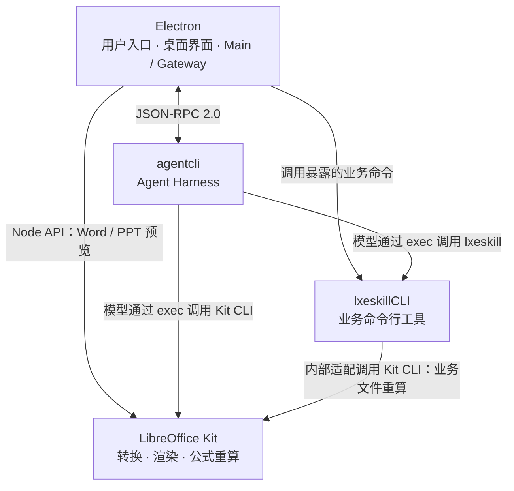

# LXE Agent

LXE Agent 是面向跨境电商运营团队的 AI 桌面助手。用户通过对话提出目标，模型结合上下文、Skill 和工具完成文件处理、数据分析与业务系统操作。

本文对应 `main` 分支。桌面程序和业务工具在本机运行，模型调用及外部业务操作按配置访问对应服务。

## 主要能力

- **对话与任务**：按工作区管理会话，发送文字和附件，查看执行过程、回答问题卡片或停止任务；也可接入飞书私聊和群聊。
- **业务操作**：通过 lxeskillCLI 提供 FBA、补货及 ERP 报表等能力，覆盖马帮、雅仓、上马、紫鸟、报关、发票、采购和退税等场景。
- **文件处理**：创建、修改和分析 Excel、Word、PowerPoint；通过 LibreOffice Kit 转换、渲染和重算文件，在桌面侧栏预览结果。
- **桌面工作环境**：浏览工作区文件，使用手动终端、浏览器和工作台，管理模型、集成与运行状态。
- **技能与工具**：加载预置及用户 Skill，使用内置 Tool、MCP 和外部 CLI；保存会话历史与用量统计。

## 架构

项目按职责分为三个主要模块，与目录或进程数量不一一对应：

| 模块 | 职责 | 主要代码 |
| --- | --- | --- |
| **Electron** | 面向用户的应用入口，负责桌面交互、侧栏与预览、配置和进程管理；Gateway 负责渠道接入、调度与结果交付。 | [desktop](apps/desktop)、[dashboard](apps/dashboard)、[gateway](apps/gateway) |
| **agentcli** | 独立的 Agent Harness，为模型提供工具、上下文和执行环境，管理会话、执行权限与统计。 | [agent-cli](apps/agent-cli)、[runtime](packages/agent/runtime) |
| **lxeskillCLI** | 通过暴露的命令提供业务能力，负责业务计算、外部系统操作、文件产出和自身业务数据。 | [lxeskill_cli](python/lxeskill_cli) |



agentcli 与 lxeskillCLI 分别管理自己的数据，通过 CLI 契约协作。对 agentcli 而言，`lxeskill` 与其他外部命令行工具一样，由模型通过 `exec` 调用；它的安装与运行不是 Agent Harness 自身成立的前提。

[skills/](skills) 存放通用和业务 Skill，为模型提供任务知识、工作上下文与操作指引，实际操作由工具或程序执行。Office 的三种调用方式见 [Office 文件能力](docs/office-runtime.md)。

## 安装与使用

正式桌面安装包面向 **Windows x64**，使用完整 NSIS 安装程序，随包提供运行所需的 Node.js、Python、Office 引擎和命令行工具。macOS 支持源码开发与生产页面预览，尚无正式签名、公证的安装包流水线。

1. 安装并启动桌面应用，设置默认工作区。
2. 使用公司云端提供的模型，或在设置中配置受支持的个人模型 API Key。已有公司网络连接时的自动模型发现见 [自动云端访问](docs/desktop/cloud-access.md)。
3. 根据任务需要配置业务集成，在桌面对话中发起任务，或通过已接入的飞书渠道使用。

关闭窗口后应用继续在托盘运行；完整退出使用托盘菜单。紫鸟业务需要用户配置的紫鸟客户端，桌面马帮认证使用 Electron 认证窗口。详细操作见 [Desktop 技术手册](docs/desktop/README.md)。

独立 TUI 产品另在 [`lxe-agent-TUI`](https://github.com/LXE123/LXE_AGENT/tree/lxe-agent-TUI) 分支维护，安装方式以该分支 README 为准。当前 `main` 也提供 [一次性 Agent CLI exec](docs/harness/runtime/agent_cli_exec.md)，可用于脚本调用，无需切换产品分支。

## 源码开发

安装 uv，以及 [package.json](package.json) 指定版本的 Bun；macOS 还需独立 Node.js >=22.19。以下命令均从仓库根目录运行：

```sh
bun install --frozen-lockfile
uv sync --frozen --all-groups
bun run desktop:dev
```

`desktop:dev` 提供 Vite 热更新；预览生产页面使用 `bun run desktop:preview`。两者都会自动准备各平台运行资源，首次准备需要联网；Python 使用当前 checkout 自己的 `.venv`。

开发时按 [AGENTS.md](AGENTS.md) 执行与改动相关的定向检查。完整源码验证使用 `bun run verify:source`，新 checkout 需先执行 `bun run desktop:tools:fd`。Windows 打包、发布及安装验收见 [打包手册](docs/desktop/packaging-pipeline.md)。

## 数据与隐私

- **存储归属**：Electron 管理桌面配置、凭据、缓存及 Gateway 接入数据；agentcli 管理 Agent 会话和统计，消息及工具记录保存在 JSONL transcript；lxeskillCLI 管理业务数据和配置。
- **数据位置**：源码开发和预览使用当前 checkout 的 `var/`；Windows 安装版默认使用 `%LOCALAPPDATA%\LXE Agent`。更换程序目录和卸载保留用户数据，迁移规则见 [程序与用户数据](docs/desktop/data-location.md)。
- **凭据**：公司下发的模型密钥与桌面保存的业务集成凭证由 Electron 安全存储加密保存；用户自行配置的模型 Key 明文保存在数据目录的 `config/auth.json`，依靠当前用户的文件系统权限保护。
- **统计同步**：按接入配置启用后，agentcli 独立上传回合、模型和工具用量，以及 Skill 读取与命令调用次数；通过公司网络按设备身份鉴权，不依赖 lxeskillCLI。详见 [统计上传](docs/harness/runtime/native-statistics-upload.md)。
- **安装包资源**：本地业务文件、认证信息、日志和 `.env` 不属于打包输入。

## 文档

- [PR 审查规范](docs/pr-review.md)：团队协作流程、共同审查重点与合并要求。
- [架构简介](docs/architecture/README.md)：三模块关系、数据归属及各模块介绍。
- [文档入口](docs/README.md)：专题手册、架构契约、验收记录和外部参考。
- [Desktop 技术手册](docs/desktop/README.md)：界面、进程、配置与开发方式。
- [Gateway ↔ Agent 协议](docs/desktop/gateway/agent-protocol.md)：JSON-RPC 2.0 通信契约。
- [Agent Runtime](docs/harness/runtime/README.md)：执行循环、上下文、会话与工具。
- [Skill 手册](docs/harness/skill/README.md)：发现、管理与统计机制；具体任务指引见 [skills/](skills)。
- [文件预览侧栏](docs/desktop/file-preview.md)与[Office 文件能力](docs/office-runtime.md)：桌面预览和文件处理。

## License

Private Project - Internal Use Only.
