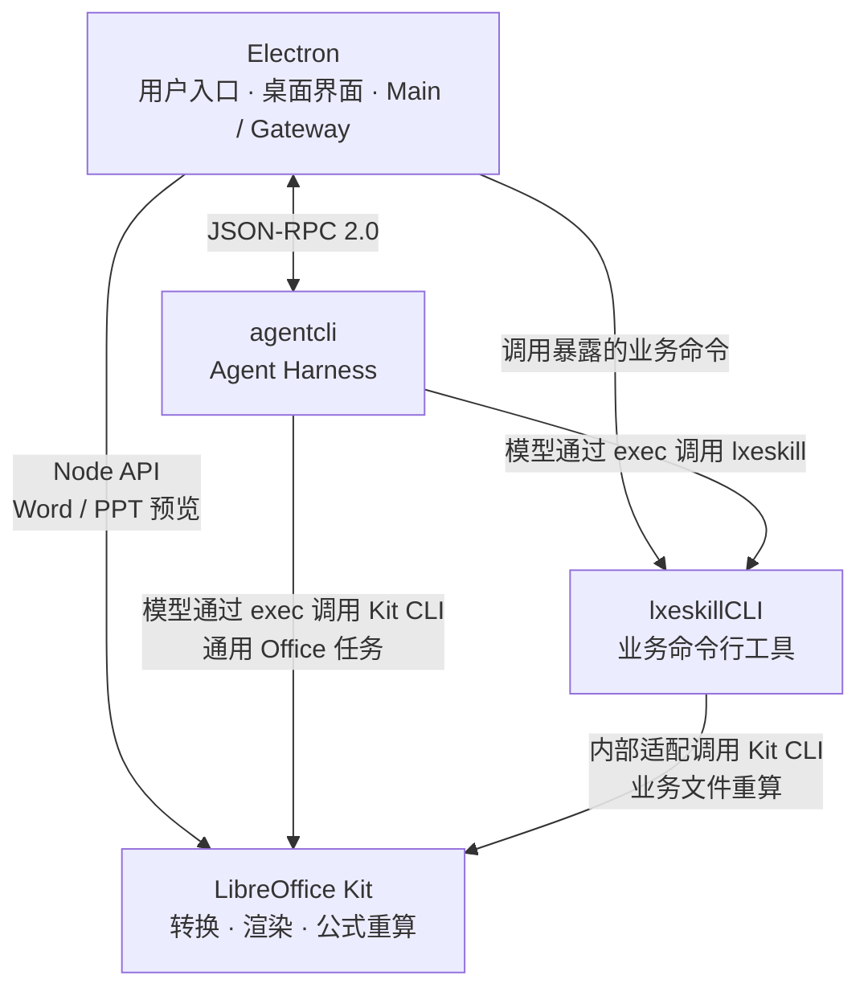

# 架构简介

审查入口：[PR 审查规范（LXE_AGENT ）](../pr-review.md)

本文介绍 LXE_AGENT 的整体架构、模块关系和数据归属。

## 1. 整体架构

LXE_AGENT 按职责划分为 Electron、agentcli 和 lxeskillCLI 三个主要模块，这与目录数量或进程数量不一一对应。

Electron 模块包括桌面界面、主进程和 Gateway；agentcli 模块包括命令行宿主和 Runtime 执行核心。

下图展示三个主要模块及 LibreOffice Kit 的调用关系：

| 模块 | 主要职责 | 主要代码位置 |
| --- | --- | --- |
| **Electron** | 面向用户的应用入口，提供统一交互界面；负责侧边栏与文件预览、系统集成、配置与进程管理，以及 Gateway 的任务接入、调度和结果交付。 | `apps/dashboard`、`apps/desktop`、`apps/gateway` |
| **agentcli** | 承载 Agent 执行核心，负责模型调用、上下文、工具执行、会话状态和执行权限。 | `apps/agent-cli`、`packages/agent/runtime` |
| **lxeskillCLI** | 通过暴露的命令提供业务能力，负责业务计算、外部系统操作和文件产出。 | `python/lxeskill_cli` |

模块之间通过明确的接口协作：

- Electron 与 agentcli 通过 **JSON-RPC 2.0** 通信。
- agentcli 通过 `exec` 调用外部命令行工具，`lxeskill` 是其中之一。
- Electron 通过 lxeskillCLI 暴露的命令调用业务能力。

## 2. agentcli 与 lxeskillCLI 的关系

agentcli 是独立的 Agent Harness，通过 `exec` 这个终端命令执行工具调用外部程序。

lxeskillCLI 和飞书 CLI、钉钉 CLI、Obsidian CLI 等外部命令行工具一样，通过提供终端命令供调用方使用。

对 agentcli 而言，lxeskillCLI 可以像其他第三方命令行工具一样使用。它独立管理自身数据，通过 CLI 契约与 agentcli 协作。

当前项目还存在少量专用集成：agentcli 为统计查询 `lxeskill list` 中的命令与 Skill 归属，并在启动 `exec` 命令时传递可用 Skill 范围。这些适配通过 CLI 查询和命令进程的环境配置完成，各模块分别维护自身数据。

## 3. 数据归属

Electron 管理桌面应用自身的设置、凭据、界面偏好、缓存和日志。Gateway 管理接入侧的会话绑定和响应路由数据。

agentcli 与 lxeskillCLI 分别管理自身的数据和数据库：agentcli 管理 Agent 会话与执行状态，lxeskillCLI 管理业务数据与配置。两者通过 CLI 的输入和输出交换所需信息，各自的内部存储结构由自身维护。

## 4. 配套资源与运行依赖

### 预置 Skill

项目在 `skills/` 中维护预置 Skill，包括通用任务指引和业务操作指引。agentcli 负责发现和加载这些资源，模型根据指引使用内置 Tool、lxeskillCLI 或其他外部工具完成任务。

Skill 是供模型读取的指引。实际执行由被调用的工具或程序完成。通用 Skill 和业务 Skill 当前都存放在项目根目录的 `skills/` 下，业务 Skill 与 lxeskillCLI 的 Python 实现分开存放。

### 共享 Office 引擎

项目通过 `@deepseek-ai/libreoffice-kit` 使用 LibreOffice 的文档转换、渲染和公式重算能力，并将其作为运行依赖随应用分发。

Kit 提供 **Node API** 和 **CLI** 两种接口，分别供程序代码和终端命令调用。各模块使用哪种接口，见上方架构图。

调用方负责业务逻辑、输入文件、产出文件和结果处理；Kit 负责执行文档处理操作。

Electron 的具体预览方式与缓存管理，见 [Electron 模块介绍](electron.md)中的“侧边栏与文件预览”和“文件服务”。

## 5. 模块介绍

- [Electron 模块介绍](electron.md)：桌面应用层的内部职责。
- [agentcli 模块介绍](agentcli.md)：Agent Harness 的内部职责。
- [lxeskillCLI 模块介绍](lxeskill-cli.md)：业务 CLI 的内部职责。
