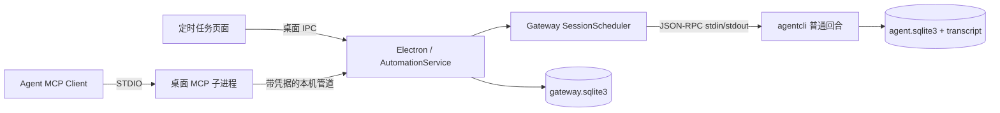

# 定时任务与桌面 MCP

定时任务由 Electron Main 管理。到时间后，Gateway 把提示词提交给 agentcli，执行普通 Agent 回合。完整回答、工具记录和文件仍在会话中；任务页保存计划和运行入口，不另存一份回答。

## 使用方式

左侧时钟入口打开“定时任务”。支持一次性任务、固定分钟间隔，以及带 IANA 时区的 RRULE 日历计划。表单提供每天、工作日预设和自定义规则，保存前可以预览未来五个时间。

- **每次新建对话**：选择工作区，可选固定模型；未指定模型时使用运行时默认模型。每次使用新的会话 ID，即使已有空白对话也不复用。不同轮次可以重叠执行。
- **沿用已有对话**：选择桌面对话，继承其历史、模型和权限。同一会话不会插入第二个自动回合。固定间隔从本次实际启动时刻重新计时；日历计划仍遵循设定的日历时间。

两种方式都沿用普通对话的权限检查与提问、审批机制。任务页可编辑、暂停、恢复、立即运行、删除，运行记录可打开对应会话并定位到那次执行的历史窗口。正在执行的记录可以停止；停止操作带 turn ID，避免误停后来启动的用户任务。

暂停只影响未来执行。编辑只影响之后启动的回合。停止复用会话中的执行，会暂停该会话绑定的活动计划；恢复计划才重新开放自动执行。删除计划保留历史记录与已有会话，删除绑定会话会暂停相关计划。一次性计划启动后即为“计划已结束”，不表示那次 Agent 执行已经成功；结果看运行记录。

## 调度与忙碌处理

启动就绪后立即检查，之后每 30 秒检查一次。每次按到期时间、任务 ID 稳定排序，最多尝试启动三个到期计划；这是启动速率，不是最多同时运行三个任务。同一计划的自动触发间隔至少 60 秒。

会话运行中、排队中、正在停止、等待回答或审批、状态尚未确认时，复用计划保留一次到期机会，稍后检查。用户正在前台编辑草稿时也会延后；页面每 20 秒续期，离开时释放，异常退出最长两分钟过期。只读对话不占用。真正入队前再次检查占用、计划版本、暂停、删除和自动执行停止状态，避免异步准备期间用户发送消息造成竞争。

忙碌、系统休眠或应用退出期间错过的重复周期合并为一次，不逐周期补跑。一百个同时间的计划在可运行时按每轮三个逐步启动；独立会话上一轮仍在运行不会阻挡其他计划。

小时、日、周 RRULE 使用确定性偏移分散启动，通常 ±300 秒；多个 BYMINUTE 为 ±119 秒。一次性、密集分钟规则、固定间隔不加偏移。偏移由持久盐、计划 ID、名义时间计算，重启保持一致。界面预览显示名义时间并解释偏移，任务详情显示实际到期时间。时区按计划保存；夏令时缺失的重复时间跳过，重复的当地时间只取第一次。一次性输入遇到夏令时歧义会报错，要求调整时间。

关闭窗口沿用现有托盘行为。应用退出、电脑关机或休眠期间不执行；这不是系统后台守护进程，也不唤醒电脑。

## 模块和持久化

`gateway.sqlite3` 新增三张表：

| 表 | 内容 |
| --- | --- |
| `automations` | ID、版本、状态与 JSON 定义；名称、提示词、时区、时间规则、目标、计划锚点、名义/实际下次时间、上次触发和阻塞原因 |
| `automation_runs` | 每次派发的不可变定义快照、触发来源、固定 session/turn ID、派发状态、时间和实际错误 |
| `automation_settings` | 随机偏移盐、内置桌面 MCP 启停偏好 |

派发前在同一 SQLite 事务内记录意图并推进计划；更新使用版本检查，领取使用完整计划状态比较。运行状态通过 `sessions.turn.lookup` 查询 Agent 的事实状态，不由桌面直接读取 Agent 数据库。重启对未确认派发进行查询，无法证实的标记“状态待确认”，不自动重发。需要用户查看会话再决定重新执行，避免重复外部副作用。这里不承诺跨进程的 exactly-once 执行。

## 桌面 MCP 接口

内置服务名 `lxe_desktop`，使用官方 SDK v2 的 STDIO 服务入口，客户端固定协商新版协议。独立进程只负责 MCP 协议适配，业务逻辑仍在 Electron；Windows 通过随机命名管道，macOS/Linux 通过私有临时目录的 Unix socket 连接。每次请求有 1 MiB 大小上限和 30 秒超时，取消及关闭会清理连接。

启动时 Electron 注入命令、脚本、管道地址和随机凭据。agentcli 取得托管配置后从普通执行环境和 `process.env` 移除这些值；其他 CLI、exec 和第三方 MCP 不继承凭据。凭据不写入 YAML 或命令参数。服务可在 MCP 管理页启停，偏好存在桌面数据库；关闭 MCP 不关闭定时调度或任务页。

只对桌面来源暴露四个工具，采用已有 deferred 工具发现机制：

- `automation_list`：列出计划、可选工作区与当前会话 ID。
- `automation_update`：创建、查看、修改、暂停、恢复、删除；修改需当前版本。`session_id=current` 由宿主解析。
- `automation_run_now`：立即执行一次，忙碌复用会话返回实际原因。
- `automation_runs`：查询派发与执行状态、会话和 turn ID。

调用身份由 Runtime 注入 MCP `_meta`，不由模型参数决定；Electron 再验证调用者确实属于当前桌面活动回合。飞书、已结束回合、无凭据请求不能调用。该边界隔离应用内调用来源，不防御已经控制同一操作系统账号的进程。

## 与参考实现的取舍及排查

沿用 Codex 的两种会话方式、分批触发、确定性偏移和复用会话忙碌延后。任务与运行记录使用项目现有 Gateway SQLite，不复制 TOML 双写；执行和结果沿用本项目 JSON-RPC 与会话窗口。第一版不提供云同步、多机器执行和自动创建 Git worktree。

遇到任务未运行，先看计划状态、下次时间和阻塞原因，再检查 Agent 是否就绪、工作区/模型是否仍可用。执行失败从运行记录打开原对话查看实际错误。连接失败会保留原始诊断，经脱敏和显式截断后返回，不以成功或空结果替代。

源码验证入口：Gateway `automations.test.ts`、Desktop `automation-store.test.ts` / `desktop-mcp.test.ts`，以及 Runtime 历史窗口测试。手动页面验收可从仓库根启动 `bun apps/dashboard/test/features/automations/fixture-server.ts`；仅使用临时内存数据库与模拟执行，不读取真实业务数据。Windows 命名管道、托盘长时间运行、安装包和真实供应商任务仍需对应平台验收。
