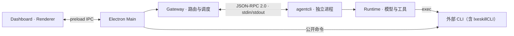

# Gateway 与 Agent 生命周期

## 目的

Gateway lifecycle 负责在 Electron Main 内管理持久化、私有 Runtime 子进程、scheduler、heartbeat 和 channel。它不提供命令行产品入口，也不监听 HTTP Dashboard 端口。

## 进程关系

桌面对话通过 IPC 接入，生产环境没有 Dashboard HTTP listener。同会话任务串行、跨会话派发和取消策略由 [Scheduler](session_scheduler_cancellation.md) 维护；步骤循环见 [Runtime 执行流程](../../harness/runtime/turn_execution.md)。

## 事实来源

- [`apps/desktop/src/main/desktop-gateway.ts`](../../../apps/desktop/src/main/desktop-gateway.ts)：桌面配置、环境和 Gateway 装配。
- [`apps/gateway/src/orchestration/composition.ts`](../../../apps/gateway/src/orchestration/composition.ts)：Router、Scheduler、Channel 和 Runtime port 的组合。
- [`apps/gateway/src/orchestration/lifecycle.ts`](../../../apps/gateway/src/orchestration/lifecycle.ts)：启动、停止、health 和失败回滚。
- [`apps/gateway/src/orchestration/process-runtime.ts`](../../../apps/gateway/src/orchestration/process-runtime.ts)：受管 `agent-cli` 子进程协议。
- [`apps/agent-cli/src/runtime-host.ts`](../../../apps/agent-cli/src/runtime-host.ts)：Agent 进程内的 Runtime composition root。

## 生产组件装配

Electron Main 创建 `ProcessAgentRuntime`、桌面 Gateway SQLite store 与可选 Feishu adapter，然后调用 `createDirectGatewayComposition()`。Feishu adapter 的图片模型输入处理器由 Desktop 显式注入，Gateway 只依赖 `InboundImageProcessorPort`，没有 Runtime fallback。Renderer 发送 `{ operation, input }` 类型化调用，经 preload IPC 进入 `DesktopGateway`；Main 处理本地健康、会话控制、状态协调及设置持久化等职责；Agent 数据操作通过 JSON-RPC 2.0 交给 `agent-cli` 内的 `DashboardService`，使用 stdin/stdout 传输和 JSONL（NDJSON）分帧。具体分发以 `DesktopGateway.call()` 为准，生产 Dashboard 没有 HTTP transport。

`ProcessAgentRuntime.isReady` 是 Runtime readiness 的唯一事实来源。Lifecycle 的 ingress 与 health 每次直接读取该值；composition 只负责在状态通知到达时把当前值同步给 Scheduler 的派发门闩。Desktop 不得直接修改 Scheduler，也不得根据另一份缓存决定是否接受或执行消息。

Desktop Cloud 的设备权限快照决定允许的 skill types，并在初始化 Agent 进程及权限热更新时传递授权结果。实际 `SkillCatalog` 过滤、Workspace scope、`ToolRegistry` 装配和 `LXESKILL_SKILL_SCOPE` 注入由 `AgentRuntimeHost` 执行，Gateway 不导入这些 Runtime 具体类。

## 启动顺序

`GatewayLifecycle.start()` 是 single-flight：

1. 验证 session binding/state 可用。
2. 启动受管 Runtime 子进程并等待 ready。
3. 启动 heartbeat bridge。
4. 将 channel inbound sink 绑定到 Router。
5. 开放 ingress 并启动 channel adapters。
6. 根据 Runtime 与 channel 的实际状态报告 health。

只有 Runtime 和 required channel 都健康时，health 才能报告可接收请求。启动任一步失败时，已尝试组件按反向依赖关系 best-effort 清理，同时保留原始错误。

## 停止顺序

正常停止先关闭 ingress，再依次停止 channel、heartbeat、scheduler readiness、active run 和 Runtime 子进程。每一步有独立超时与错误收集；重复 stop 共享同一任务。

需要重启后台的配置变更复用同一 stop/start 路径；支持热更新的模型和权限配置按各自接口生效。Main 在后台停止后关闭桌面存储，并清理其持有的媒体任务和认证宿主。马帮认证的受控本机服务是独立链路，见 [浏览器认证](../../../python/lxeskill_cli/browser_auth_service/README.md)。

## Health 解释

Health snapshot 汇总 Runtime readiness、channel health、ingress 状态和最后错误。`ready=false` 表示不能安全接受新消息，不代表 Electron 已退出。诊断应通过桌面设置中的状态卡和日志目录完成，而不是检查端口或浏览器页面。

## Agent 进程内的启停

`AgentRuntimeHost` 负责宿主级服务，Runtime 先打开 Agent store，再启动已注册的进程管理、统计同步、Skill 初始化和 MCP 等服务。启动失败时回收已经启动的服务并关闭 store；正常停止时清理服务、Workspace 缓存和存储，宿主同时结束提问、审批及图片上传等资源。

Runtime 不自行接管 Gateway 尚未完成的接入任务。已启动的 `exec` 进程归 Session 所有，单次 turn 取消与进程终止不是同一操作，见 [工具生命周期](../../harness/runtime/tools/README.md#cancel-与-exec-生命周期)。
