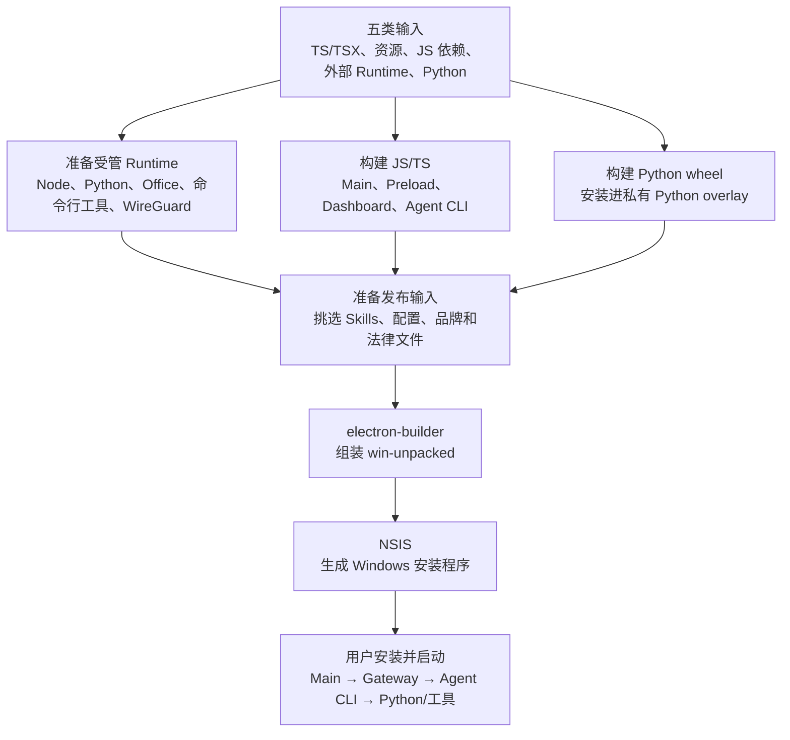
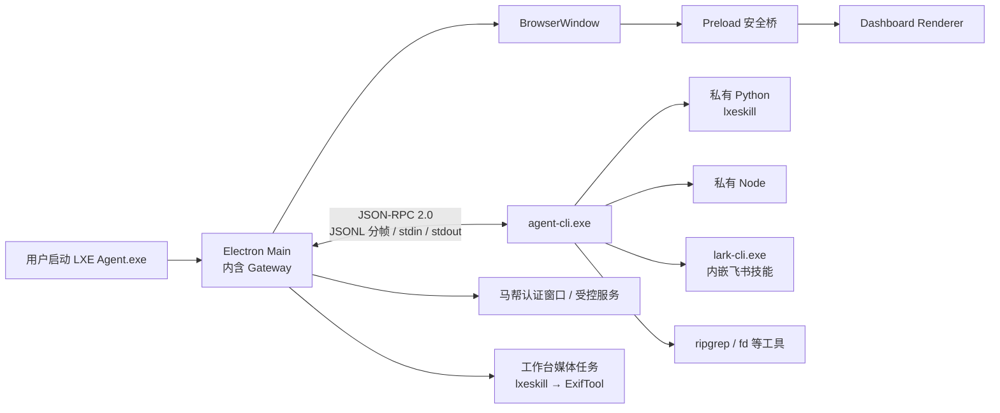

# Electron 桌面应用：构建、打包、安装与启动

这篇文档用大白话说明 LXE Agent Desktop 是怎么从一份源码，变成 Windows 安装程序，再变成一套正在运行的桌面应用。

这里重点讲主流程。具体版本号、资源白名单和脚本实现仍以仓库代码为准。

## 先看常用命令

在仓库根目录运行下面的命令。

| 想做什么 | 命令 | 最终得到什么 |
| --- | --- | --- |
| 开发桌面界面 | `bun run desktop:dev` | Vite 热更新页面和源码运行的 Electron |
| 预览生产版页面 | `bun run desktop:preview` | 生产版 Dashboard，但 Gateway 和 Agent Runtime 仍从源码运行 |
| 单独准备 Mac 工具 | `bun run desktop:tools:mac` | 项目私有的 ExifTool 13.59 和 fd 10.5.0；开发和预览会自动执行 |
| 单独准备文件搜索工具 | `bun run desktop:tools:fd` | 当前平台的固定版本 fd 10.5.0 |
| 只检查源码 | `bun run verify:source` | 类型检查、Bun 测试和 Python 测试结果，不生成安装包 |
| 准备 Windows 私有运行环境 | `bun run desktop:runtime:win` | 可重复使用的 Node、Python、Office 和命令行工具等受管 Runtime |
| 快速检查真实打包目录 | `bun run desktop:pack:win` | `dist/desktop-unpacked/win-unpacked/LXE Agent.exe` |
| 生成 Windows 安装程序 | `bun run desktop:dist:win` | `dist/desktop/LXE-Agent-<version>-windows-x64.exe` |
| 构建正式候选 | `bun run release:build` | 同步冻结依赖、准备 fd、完整验证、生成 NSIS 并记录当前候选 |
| 发布当前候选 | `bun run release:publish` | 校验当前候选，输入 y 后发布 |

平时最常用的是三条：

- 改代码时用 `bun run desktop:dev`。
- 想确认真实打包目录时用 `bun run desktop:pack:win`。
- 准备发布时用 `bun run release:build`；`verify:platform:win` 是其兼容别名。

目前正式打包只支持 **Windows x64**。macOS 可以运行源码版、预览版和工作台媒体标签，但不生成正式 DMG。

新 checkout 直接运行 `bun run verify`、`bun run verify:source` 或 `bun run verify:platform` 前，先执行一次 `bun run desktop:tools:fd`。真实 `find` 集成测试必须使用 fd 10.5.0；测试本身不会下载工具，也不会因为缺少 fd 就跳过。Windows 的 `verify:platform:win` 和 Mac 的 `verify:platform:mac` 已在源码验证前自动准备所需工具。准备步骤会校验并复用有效缓存；只有缓存缺失或失效时才下载，准备失败会停止后续验证和打包。

Mac 第一次运行 `desktop:dev` 或 `desktop:preview` 时，会自动下载约 8 MB 的 ExifTool 13.59 完整 Perl 版本，核对固定 SHA-256，再把 `exiftool` 和 `lib` 放进项目的 `build/desktop-runtime/darwin-<arch>` 缓存。以后启动只检查并复用缓存，不要求用户另外安装 ExifTool。这个缓存服务于源码开发，不会把缺少其他私有 Runtime 的 Mac 应用伪装成正式安装包。

### 正式打包时选择版本

正式安装包的版本和更新说明来自已提交的 `config/desktop-release.json`。构建不会自动加版本，也不会修改仓库的占位版本；通过 `LXE_DESKTOP_PRODUCT_VERSION` 注入 electron-builder。源码和说明必须已提交，构建中不得改变。

日常发布使用 `bun run release:build` 和 `bun run release:publish`：前者同步冻结依赖、验证和打包并记录当前候选；后者校验并展示候选后等待输入 `y` 发布。构建失败或中断不回退旧包，源码变化后需重新构建。详见 [Windows 更新与发布](updates.md)。

`desktop:dist:win` 保留为独立 NSIS 打包入口，生成候选但不更新默认待发布记录。`desktop:pack:win` 是开发用 Unpacked 路线，仍使用本地开发版本选择文件，不属于正式发布流程。

## “构建”“打包”“安装”“启动”不是一回事

这四个词经常被混在一起，其实它们分别解决不同的问题：

1. **构建**：把人写的源码变成机器能直接运行或读取的产物。例如把 TypeScript 变成 JavaScript，把 Python 项目变成 wheel。
2. **组装**：把程序、运行环境、工具和配置放进正确的目录，让它们能互相找到。
3. **打包**：把组装好的应用目录压缩并封装成 Windows 安装程序。
4. **安装和启动**：安装程序把文件释放到用户选择的目录；用户启动应用后，各个进程才真正开始工作。

可以把它想成搬家：先把物品加工好，再按房间装箱，然后把箱子运到新家，最后拆箱开工。

## 打包前有五类输入

LXE Agent 不是只有一个 Electron 页面。它同时包含 TypeScript、Python、浏览器、命令行工具和大量产品资源。不同输入不能用同一种方式处理。

先分清一个容易混淆的地方：V8 负责执行 JavaScript，Chromium 负责解析和显示 HTML、CSS。Electron 把 Chromium、V8 和 Node 组合在一起，但这不代表安装包里的 Python、外部 Node 和其他 EXE 也由 Electron 编译或执行。

### 1. 自己编写的 TypeScript 和 TSX

主要包括四块：

- Electron Main：桌面应用的主进程。
- Electron Preload：Main 和页面之间的安全桥梁。
- Dashboard：用户看到的 React 页面，也就是 Renderer。
- Agent CLI：独立运行的 Agent 后台程序。

前三者最终在 Electron 中运行；Agent CLI 则编译成独立的 `agent-cli.exe`，由 Main 内的 Gateway 启动。

### 2. 产品资源

这类文件分成两种处理方式：Dashboard 使用的 HTML、CSS、图片和字体会先交给 Vite；其余产品文件主要经过白名单挑选后原样带进应用：

- HTML、CSS、图片和字体。
- 各个 Skill。
- JSON、YAML 和环境默认配置。
- Dashboard 构建后的静态文件。
- 图标、许可证和第三方声明。

本机的 `.env`、登录态、数据库、日志和业务文件不会因为放在仓库附近就自动进入安装包。资源准备脚本只选择产品明确允许的文件。

### 3. 第三方 JavaScript 依赖

例如 React、飞书 SDK，以及 workspace packages 中的 TypeScript/JavaScript 代码。

它们通常会跟随自己的使用入口，被 Bun 或 Vite 一起打进对应产物。这样安装后的应用不需要回到源码仓库找这些依赖。

### 4. 外部 Runtime 和工具

这些本来就是可以直接运行的程序，不应该再交给 Bun 或 Vite 编译：

- 私有 Node.js。
- 私有 Python。
- LibreOffice Kit 及其完整运行依赖，放在 `runtime/office`；版本、准备和验证见 [Office 文件能力](../office-runtime.md)。
- Electron 提供桌面马帮认证窗口；独立 CLI 使用用户绑定的 Chrome/Edge。安装包保留 Playwright 控制库，不携带独立 Chromium。
- ripgrep 和 fd。
- ExifTool，用来读取和写入图片、视频元数据。
- WireGuard 安装包和受控配置脚本。
- 独立的 Lark CLI 可执行文件，内嵌飞书技能说明。

此外，发布资源阶段会构建 Windows 执行沙箱启动器及其依赖，放在 `runtime/exec-sandbox`，使用随包 Node 运行。写入限制与平台边界见 [权限专题](../harness/runtime/permission-policy.md#临时目录与执行后端)。

这里的“私有”是指它们跟着 LXE Agent 一起分发，只供 LXE Agent 的子进程使用，不依赖用户电脑是否提前安装，也不会修改系统 `PATH`。

需要特别区分两套 Node：

- Electron 自带的 Node 和 Chromium，用来运行 Electron Main、Preload 和页面。
- `resources/runtime/node` 中的私有 Node，供需要 Node 的外部脚本或库使用；飞书主 CLI 直接运行独立 EXE。

### 5. Python 项目代码

主要是 LXE Skill CLI，也就是 `lxeskill`，以及它需要的 Python 依赖。

Python 代码不能交给 V8 运行，所以它走自己的构建路线：先用 `uv build` 生成 wheel，再把 wheel 安装进应用携带的私有 Python。安装包提供独立的 `lxeskill` 命令入口，Electron 把入口所在目录加入子进程 PATH，Agent 按普通外部命令调用：

```text
lxeskill ...
```

这样不需要用户安装 Python，也不需要让 agentcli 了解 CLI 的 Python 启动方式。命令入口负责找到随包解释器；工具的文件写入限制仍由通用执行沙箱控制，见 [权限专题](../harness/runtime/permission-policy.md)。

## 整条流水线



实际脚本会按下面的顺序执行。

## 第一步：准备受管 Runtime

Windows 打包首先准备应用自带的运行环境，包括 Node、Python、Office、ripgrep、fd、ExifTool 和 Lark CLI。WireGuard MSI 也会在这个阶段单独准备。

第一次联网构建需要下载这些固定版本的文件。准备完成后会保存在本地缓存中，后续构建可以直接复用，避免每次都重新下载几百 MiB 的 Runtime。

这一步只是在准备“底座”，还没有把当前 LXE 项目代码装进去。这样修改一行业务代码时，不需要重新下载整套 Python、Office 和命令行工具。

对应命令是：

```powershell
bun run desktop:runtime:win
```

日常执行 `desktop:pack:win` 或 `desktop:dist:win` 时，公共打包脚本也会自动准备或复用这套 Runtime，一般不需要提前单独运行。

固定版本与下载输入以 [`runtime.lock.json`](../../config/desktop-runtime/windows-x64/runtime.lock.json)、[`fd.lock.json`](../../config/desktop-runtime/fd.lock.json)、[`lark-cli.lock.json`](../../config/desktop-runtime/lark-cli.lock.json) 和准备脚本为准。运行时默认位于 `build/desktop-runtime/win32-x64`，缓存位于 `build/desktop-runtime-cache/win32-x64`；可通过 `LXE_DESKTOP_RUNTIME_ROOT`、`LXE_DESKTOP_CACHE_ROOT` 或脚本的 `-RuntimeRoot`、`-CacheRoot` 指定不同目录，显式参数优先。目录必须分开且不能互相嵌套，不修改系统 Python 或源码 `.venv`。

已有完整缓存时，可从仓库根执行离线 Unpacked 构建：

```powershell
powershell -NoLogo -NoProfile -ExecutionPolicy Bypass -File scripts/build-desktop-windows.ps1 -PackageTarget Unpacked -Offline
```

离线模式也覆盖 wheel 构建；缓存缺少下载物、依赖或 Hatchling 构建后端时明确失败。构建输入由 `build/desktop-runtime-inputs.json` 描述，字段及覆盖规则见 [`build-desktop-windows.ps1`](../../scripts/build-desktop-windows.ps1)。

## 第二步：构建当前项目代码

### Electron Main：Bun build

Main 是桌面应用的“大脑”，权限最高。它负责：

- 创建窗口和托盘。
- 读取本地配置、数据库和日志目录。
- 在同一个进程中启动 Gateway。
- 启动和管理 `agent-cli.exe`。
- 管理应用启动、退出和后台生命周期。

Main 源码从 `apps/desktop/src/main.ts` 出发，通过 Bun 构建成：

```text
apps/desktop/dist/main.js
```

### Electron Preload：Bun build

Preload 是 Main 和 Dashboard 之间的安全桥梁。它只向页面开放经过允许的 API，Dashboard 不能直接访问 Node、文件系统或 Shell。

它通过 Bun 构建成 CommonJS 文件：

```text
apps/desktop/dist/preload.cjs
```

Main 和 Preload 必须分开构建，因为它们处在 Electron 的不同安全区域，运行方式也不同。

### Dashboard：Vite build

Dashboard 是用户直接看到的 React 页面。Vite 从页面入口出发，处理 TSX、HTML、CSS、图片和字体，并把第三方前端依赖一起整理成生产静态文件：

```text
apps/dashboard/dist/
```

安装后不再启动 Vite，也不再启动本地 Dashboard HTTP Server。Electron 通过 `app://lxe/` 直接加载这些静态文件。

### Agent CLI：Bun compile

Agent CLI 也是 TypeScript 编写的，但它不是 Electron 页面的一部分。Bun 把它和运行所需的代码、Bun Runtime 一起编译成一个独立程序：

```text
dist/agent-cli/agent-cli.exe
```

应用启动后，Gateway 会把它作为子进程启动，通过 stdin/stdout 传输 JSON-RPC 2.0 消息，采用 JSONL（NDJSON）分帧：每行一个 JSON 对象或 batch 数组。

### LXE Skill CLI：uv build

打包脚本会从当前源码构建 LXE 项目 wheel，并把其中的 `lxeskill` 安装到一个很小的 Python overlay：

```text
build/desktop-publish/python-site-packages/
```

electron-builder 组装时，再把这个 overlay 合并到私有 Python 的 `Lib/site-packages`。因此每次打包都会带上当前 Python 源码，同时可以复用那套很大的基础 Python 解释器与依赖。基础缓存不保存项目 wheel，wheel 构建输出每次重新生成，避免发布旧业务代码。

Windows 打包时，通过 `uv` 在临时、可迁移的构建环境中生成标准 `lxeskill.exe`，只取命令入口，放在 `runtime/python/python.exe` 旁边；入口按相对位置寻找解释器，不保留构建机绝对路径，也不分发这个临时环境。源码开发继续使用 `uv sync --frozen` 安装到各自 `.venv` 的入口。macOS 的私有运行时入口位于 `runtime/python/bin/lxeskill`，调用同目录的 `python3`。

桌面业务调用和健康检查使用入口的明确路径；agentcli 的 `exec` 和统计查询使用 PATH，不把 `lxeskill` 改写成 Python 命令。通用 Python 命令的解释器选择与这条 CLI 链路无关。入口构建见 [`prepare-lxeskill-launcher.ts`](../../scripts/prepare-lxeskill-launcher.ts)。打包完成后会在源码目录外、仅含随包工具的 PATH 上执行 `lxeskill list`，验证实际交付的入口。

应用装配受管运行环境和直接调用 CLI 时，会清理继承的 `PYTHONHOME`、`PYTHONPATH` 等 Python 配置，再设置 UTF-8、禁用用户包等固定选项，避免其他 Python 安装或 checkout 干扰源码与打包入口。这属于子进程环境准备，不在 `exec` 中识别或改写 `lxeskill` 命令。标准 CLI 入口本身不等于 `python -I`；污染环境回归测试单独覆盖这条调用链。

资源装配从模块各自的生产输出直接生成 `extraResources`。最终不携带 wheel 文件、旧冻结版 `runtime/lxeskill`、构建用 `uv.exe`、npm/npx 和 npm 缓存。Playwright 控制库复用私有 Node，移除其重复 Node；安装包不包含 `runtime/playwright` 浏览器目录。Electron 启动时执行 `lxeskill list` 检查 CLI 入口，打包成功不能代替这项检查，检查成功也不代表各业务服务均可用。

## 第三步：准备发布资源

这一步不再编译业务代码，主要做两件事：

1. 检查 Main、Preload、Dashboard、Agent CLI、wheel 和各个 Runtime，并构建 Windows exec 沙箱启动器、安装当前项目的 Python overlay。
2. 根据产品资源范围，生成一份给 electron-builder 使用的配置。

资源采用白名单选择。要放进安装包的 Skill、配置、品牌图片和法律文件都会明确列出；本机凭证、会话、日志、缓存和业务数据不是输入。

生成的临时配置位于：

```text
build/desktop-publish/electron-builder.json
```

它在基础 `apps/desktop/electron-builder.yml` 上补充当前构建真正要复制的 `extraResources`。

## 第四步：electron-builder 组装应用目录

electron-builder 把前面准备好的产物组装成一个完整的 Windows 应用目录。这里最重要的是分清 `app.asar` 和 `extraResources`。

### app.asar 放 Electron 自己的核心代码

当前主要包含：

```text
main.js
preload.cjs
```

`app.asar` 是 Electron 常用的应用代码归档。它适合放 Main 和 Preload，但不适合放需要直接作为外部程序启动的大型 Runtime 和 EXE。

### extraResources 放运行时和产品资源

飞书 CLI 从官方固定版本的 Windows x64 ZIP 下载，核对锁文件中的 SHA256 后解压，将 `lark-cli.exe` 准备到 `build/desktop-runtime/win32-x64/tools/`。`extraResources` 直接复制该程序到 `resources/runtime/tools/`，许可证复制到 `resources/legal/lark-cli-LICENSE.txt`。不再通过 npm 安装飞书，也不复制整个 `node_modules` 来携带它。

electron-builder 的 `afterPack` 在资源复制完成、生成安装器之前，检查包内飞书 CLI、文件预览资源和 Office。飞书检查清除系统工具 PATH，验证固定版本、技能列表和 `lark-doc` 内嵌说明；Office 检查完整资源并执行实际文件处理。缺失或执行失败会中止打包。入口见 [verify-packaged-office.cjs](../../scripts/verify-packaged-office.cjs)，不登录或调用飞书业务 API；Windows 打包需要在 Windows 主机执行。

主要目录如下：

```text
resources/
├── app.asar
├── dashboard/
├── runtime/
│   ├── agent-cli/agent-cli.exe
│   ├── node/
│   ├── office/
│   ├── exec-sandbox/
│   ├── python/
│   └── tools/
│       ├── rg.exe
│       ├── fd.exe
│       ├── lark-cli.exe
│       └── exiftool/
│           ├── exiftool.exe
│           └── exiftool_files/
├── wireguard/
├── skills/
├── lxeskill/catalog.json
├── config/
├── branding/
└── legal/
```

以上为主要资源目录，完整复制范围以 [资源白名单](../../config/desktop-packaging/resource-scope.json)和准备脚本为准。

Dashboard 放在 `resources/dashboard`，因为 Main 要通过 `app://lxe/` 按文件加载页面。Agent CLI、Python、Node 和其他工具放在 ASAR 外，是因为操作系统或子进程需要直接访问和执行它们。

完成后得到：

```text
dist/desktop-unpacked/win-unpacked/
```

或者正式路线中的：

```text
dist/desktop/win-unpacked/
```

这个目录已经是一套完整、可运行的 Electron 应用。Electron 自带的 Chromium、Node、DLL 和 `LXE Agent.exe` 也由 electron-builder 放在这里。

## 第五步：NSIS 生成安装程序

`desktop:pack:win` 到 `win-unpacked` 就停止，适合快速检查真实目录结构，不花时间生成安装程序。

`desktop:dist:win` 会继续调用 NSIS：

```text
win-unpacked
    → 7z 应用载荷
    → NSIS 安装/升级/卸载逻辑
    → LXE-Agent-<version>-windows-x64.exe
```

安装程序允许用户选择安装目录，并创建桌面和开始菜单快捷方式。手动换目录会保留旧安装；应用内更新沿用原目录。数据独立放在 `%LOCALAPPDATA%\LXE Agent`，卸载始终保留数据和 WireGuard 配置。旧版 `var` 的迁移见[程序与用户数据](data-location.md)。

WireGuard MSI 虽然已经放进安装包，但普通安装过程不会直接安装 WireGuard。只有用户配置公司云端设备时，应用才按需请求 UAC 权限并执行受控安装和隧道配置。

## 安装之后是什么样

可以把安装目录粗略理解成下面这样：

```text
LXE Agent/
├── LXE Agent.exe
├── Electron、Chromium 和 DLL
├── resources/
│   ├── app.asar
│   ├── dashboard/
│   ├── runtime/
│   ├── skills/
│   ├── config/
│   └── ...
└── var/                    # 仅旧安装可能保留的原数据

%LOCALAPPDATA%/LXE Agent/   # 独立的用户数据目录
├── config/
├── db/
├── logs/
├── tmp/
└── workspace/
```

`resources` 是随版本发布的程序和只读资源；用户数据目录保存配置、数据库、日志和默认工作区。程序换位置后继续使用同一份用户数据。

## 用户启动应用后发生什么

用户双击 `LXE Agent.exe` 后，主链路是：

1. Electron Runtime 启动，并从 `app.asar` 加载 `main.js`。
2. Main 确定程序资源和独立数据目录，取得单实例锁；首次启动先迁移旧数据，再初始化配置、日志和数据库。
3. 配置完成后，Main 在自己的进程里启动 Gateway。
4. Gateway 启动 `resources/runtime/agent-cli/agent-cli.exe` 子进程，通过 JSON-RPC 2.0 与它通信，使用 stdin/stdout 传输和 JSONL（NDJSON）分帧。
5. Agent CLI 按任务需要调用私有 Python、`lxeskill`、Node CLI、ripgrep 或 fd；马帮认证通过 Main 的受控服务操作独立 Electron 窗口，紫鸟使用用户配置的客户端和配对 Selenium。桌面媒体任务由 Main 调用 `lxeskill` 媒体命令，并使用 ExifTool。
6. Main 创建 BrowserWindow，通过 Preload 暴露的白名单 IPC，让 Dashboard 与 Main、Gateway 和 Agent 交互。



关闭窗口只会把应用隐藏到托盘，Gateway 和 Agent 仍可在后台工作。从托盘选择退出后，Main 才会依次停止 Gateway、Agent 和相关子进程。

## 两条打包路线怎么选

### `desktop:pack:win`：检查真实目录

这条路线会构建当前 wheel、Agent CLI、Dashboard 和 Electron，准备全部资源，生成真实 `win-unpacked`，统计体积并检查打包资源。

它适合日常确认：

- 有没有漏带文件。
- 目录是否符合真实安装后的布局。
- Runtime、整个应用及各类资源分别占用多少空间。

它不会自动启动产物，也不会验证安装目录、快捷方式、升级、卸载和 WireGuard UAC 行为。

### `desktop:dist:win`：生成安装程序

这条路线包含前面的完整组装，并继续生成 NSIS 安装程序。它适合制作交给测试人员或用户安装的产物。

它本身不先执行全部源码测试。正式发布时应使用：

```powershell
bun run release:build
```

这个命令先检查 Windows x64 平台和干净源码，同步冻结依赖并执行 `desktop:tools:fd`，再执行一次 `verify:source`，最后执行一次 `desktop:dist:win` 并记录当前候选。这样全新工作区也能在真实 `find` 测试开始前获得 fd，不必提前准备整套 Node、Python 和 Office；完整 Runtime 仍在打包阶段准备，同一批生产代码只构建一次。

## 当前自动门禁和人工边界

打包过程会检查关键输入和最终 `LXE Agent.exe` 是否存在，还会生成资源体积报告：

```text
desktop-resource-sizes.json
```

报告记录解包后文件的字节总量和文件数，按 Electron、Python、Node、Office、Agent CLI 等分类。报告版本为 `schema_version: 2`，不再包含 `budgets` 字段。体积只用于观察，不设固定上限，也不会因为体积增长阻止打包。

资源体积报告中的检查要求：

- 不携带独立的 Playwright Chromium 浏览器目录内容。
- Python 的 Playwright driver 不携带重复的 Node 可执行文件。
- ExifTool 可执行文件和非空的 `exiftool_files` 支持目录齐全。

报告先写入磁盘，再检查资源；资源检查失败会终止打包并保留报告。正式路线通过检查后才记录发布候选。

当前流水线不会自动启动打包后的应用，也不会自动走完安装、升级和卸载。因此正式发布前，仍需要在 Windows 测试机上人工确认：

- 安装程序能正常打开并选择目录。
- 快捷方式能启动应用。
- 首次配置和 Dashboard 正常。
- Gateway、Agent CLI 和 `lxeskill` 健康状态正常。
- 覆盖升级后实际用户数据目录中的数据库、配置和文件保留；从旧安装目录 `var/` 升级时，另检查迁移与回退，见 [程序与用户数据](data-location.md)。
- 卸载及旧删除参数均保留用户数据；卸载旧副本不会移除新安装的注册信息和快捷方式。
- 公司云端设备场景下的 WireGuard UAC 和隧道配置正常。
- 工作台能分别处理一张图片和一个视频，输出文件带有目标标签，而且原文件没有变化。

## 发布边界

Windows 签名使用 electron-builder 的 `CSC_LINK` 与 `CSC_KEY_PASSWORD`，凭据不提交仓库。macOS 源码验证不覆盖私有 Runtime 分发、签名或 notarization；未建立对应流水线前，不将普通 Mac 构建视为正式安装包。

资源选择、裁剪、体积统计和资源检查以 [`prepare-desktop-resources.ts`](../../scripts/prepare-desktop-resources.ts) 与 [`report-desktop-resource-sizes.ts`](../../scripts/report-desktop-resource-sizes.ts) 为准，避免沿用旧安装包体积样本作为当前保证。
