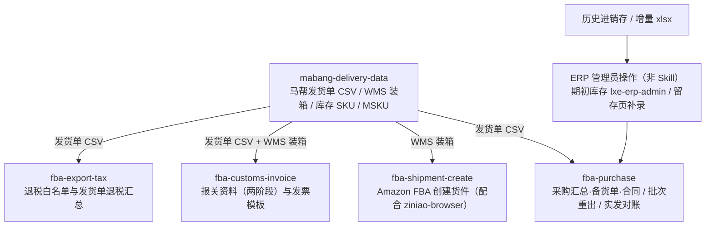

# FBA 流程导览

根据用户任务说明相关子流程，再按下表转到对应的 FBA Skill 或管理员入口。只有 `SP...` 单号但未说明用途时，先确认是导数据、采购、建货件、核销对账还是做单证/退税。

## 全流程关系图

## 路由与术语对照表

| 业务需求 / 术语 | 路由去向 | 关键说明 |
|---|---|---|
| 下载 FBA 发货单 CSV、WMS 装箱 Excel、库存 SKU 表、MSKU 明细 | `mabang-delivery-data` | 发货单 CSV（`MSKU发货量`）供采购、实发对账、退税共用；WMS Excel 供建货件、发票、报关使用 |
| 按一批 SP 生成采购汇总表、备货单与正式合同（或 `--preview` 预览） | `fba-purchase` | 需出口退税总表和合同模板（长期资产）；默认走 ERP FIFO 抵扣，仅用户明确要求时 `--inventory-deduction-mode none`；正飞均价按整批新采购量计算 |
| 明确仅用 ERP 留存库存为已有 SP 独立创建发货单 | `fba-purchase` | 走 `fba stock-shipment create`，逐单报价并按 `--confirm-quote` 确认建单；不需要总表、合同模板或毛利率，不生成采购 Excel |
| 按 ERP 批次号 `PB...` 重出采购汇总/备货单/合同，或单 SP 备货单兼容生成 | `fba-purchase` | 重出文件只读 ERP 冻结快照；单 SP 备货单兼容入口不出合同、不写 ERP |
| 上传真实发货量到 ERP、申报待装箱 SP 整单不发、库存 SKU 对账或留存预览 | `fba-purchase` | 读取默认最新发货单 CSV、`--delivery-csv` 修订版 `MSKU发货量`，或 `--all-unshipped` 零实发申报，先预览再经用户确认写入 |
| 创建 Amazon FBA 货件（上传装箱、多包装箱、确认承运人、填追踪号） | `fba-shipment-create` | 先经 `ziniao-browser` 获取运行中 `store_id`，再执行四阶段 CLI |
| 填写报关资料（申报要素/报关单/发票/箱单/合同）或 `invoice_Template` | `fba-customs-invoice` | 报关：汇总表售价 + 自动重下发货单经 ERP 预览后生成 + WMS 取箱重；发票：单 SP 备货单 + 本地 CSV + WMS 分箱实发量 |
| 维护出口退税白名单或统计发货单退税 SKU | `fba-export-tax` | 共享出口退税产品白名单（长期资产） |
| 初始化 ERP 期初库存（历史进销存表） | 非 Agent Skill | 部署前一次性管理操作，由后端服务器管理员执行 `lxe-erp-admin opening-inventory` |
| 补录 ERP 上线前历史 SP 剩余库存（历史库存增量表） | 非 Agent Skill | 在 ERP「留存库存」页由管理员执行「补录历史库存」 |
